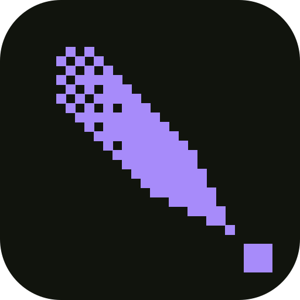

# tenten

A headless pixel-art and animation tool for coding agents. Sprites are indexed (a palette, index 0 transparent) with layers, frames, tags and slices. An MCP server and a CLI are the only interfaces; there is no editing GUI. Every edit returns the frame as a text grid so the model sees what it drew.

Inspired by Aseprite, not a clone of it. The `.tt` file is JSON with cels stored as text grids, so it reads with `cat` and diffs in git. Exports write PNG sheets and Aseprite-style JSON that Phaser's `load.aseprite` and Pixi's spritesheet parser accept, and the `name@WxH.png` strips debuff's asset compiler reads.

Part of [debuff](https://github.com/debuffjp/debuff), the toolkit for 2D browser games. Projects made with `npm create debuff` list tenten in their `.mcp.json`, and the `tenten()` plugin in `@debuffjp/cli` turns `.tt` files in `assets/` into sprite sheets, fetching tenten with npx when it is not installed.

## Use it from an agent

```json
{ "mcpServers": { "tenten": { "command": "npx", "args": ["-y", "-p", "@debuffjp/tenten", "tenten-mcp"] } } }
```

Or from a checkout: `node bin/tenten-mcp.js`. Twelve tools: `tt_new`, `tt_open`, `tt_save`, `tt_describe`, `tt_draw`, `tt_undo`, `tt_render`, `tt_diff`, `tt_export`, `tt_watch`, `tt_preview`, `tt_palettes`. A sprite is usually one `tt_draw` call with a `grid` op:

```json
{ "ops": [
  { "op": "grid", "rows": ["..0000..", ".011110.", "01122110", "01111110", ".011110.", "..3..3.."] },
  { "op": "outline", "c": 4 },
  { "op": "addFrame" }, { "op": "shift", "dx": 0, "dy": 1, "frame": 1 },
  { "op": "tag", "name": "idle", "from": 0, "to": 1 }
] }
```

In a grid `.` is transparent and `0-9a-zA-Z` are palette indices 1 to 61, so index 1 is drawn as `0`. `tt_describe` lists each palette entry with its grid character, as `1=#ffd700 (0)`. `tt_render` with `view: "png"` draws every frame zoomed with its index under it. `tt_diff` lists the pixels that differ between two frames or two documents.

`tt_preview` opens a small page for the human that shows every open document zoomed and plays its animations, updated on every change. `tt_watch` re-exports a document to a directory after every change, so a dev server watching that directory (debuff, Vite) reloads the art as the agent draws. `tt_open` and `tt_save` take `.aseprite` as well as `.tt`.

## .aseprite

Reads RGBA, grayscale and indexed files with raw, compressed or linked cels at any offset, and writes indexed files with a palette, layers, tags and slices. The tests render Overbuffed's Aseprite files to the PNGs Aseprite exported from them, pixel for pixel, and, when Aseprite is installed, have the real binary open a tenten-written file and export the same sheet. The codec is written from the published file spec, not from Aseprite's source.

## CLI

```
tenten show <file> [--frame n]
tenten info <file>
tenten export <file> [--out dir] [--layout horizontal|vertical|grid] [--scale n] [--padding n] [--frames] [--debuff] [--aseprite]
tenten preview <file> [--out file.png] [--scale n]
tenten convert <file> <out>
```

`<file>` is `.tt` or `.aseprite`.

## Library

```ts
import { Editor, save, sheet } from "@debuffjp/tenten";
const e = Editor.create("coin", 8, 8);
e.batch([{ op: "palette", colours: ["#ffd700", "#b8860b"] }, { op: "ellipse", x: 0, y: 0, w: 8, h: 8, c: 1, fill: true }]);
await save(e.doc, "coin.tt");
```

Ops: `grid`, `pixel`, `line`, `rect`, `ellipse`, `diamond` (a 2:1 isometric footprint), `flood`, `outline`, `shift`, `flip`, `replace`, `copy`, `clear`, `addLayer`, `removeLayer`, `addFrame`, `removeFrame`, `duration`, `tag`, `untag`, `slice`, `unslice`, `colour`, `palette`. A batch is one undo step and rolls back whole if an op fails.

## Not yet

Tilemap layers and tilemap cels in `.aseprite`, brushes, in-place texture swapping without a reload (today `tt_watch` rewrites files and the dev server reloads). Node 24 runs the TypeScript source directly; `npm run check` typechecks and runs the tests.
